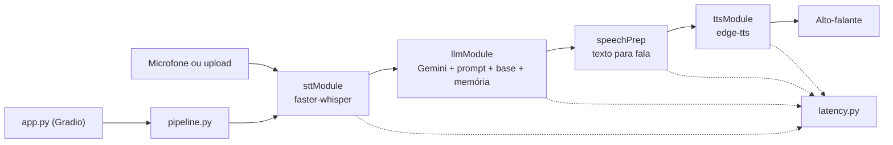

# Orienta Saúde Voz

Assistente de voz em português da Global Solution 2027 de Processamento de Linguagem Natural (CitizenTech). Estende o projeto Orienta Saúde (Front-end): o cidadão **fala** o que está sentindo e **ouve** se deve cuidar em casa, ir à UBS, à UPA ou ligar para o SAMU (192).

**Integrante:** Guilherme Gama Bitencourt Souza · RM565293

## Persona, problema e ODS

- **Persona:** Dona Maria, 68 anos, baixa escolaridade, tem dificuldade para digitar no celular. Também serve cuidadores de crianças, pessoas com deficiência visual ou motora e quem está com as mãos ocupadas.
- **Problema:** sem saber se o caso é de UBS, UPA ou SAMU, muita gente vai à UPA com casos simples. Em Ijuí (RS), de jan. a jun. de 2025, cerca de 80% dos 49.642 atendimentos da UPA foram verdes ou azuis (Manchester), segundo CULPO et al., Unijuí 2025 (estudo de um município, não representa o Brasil). A voz tira a barreira do texto.
- **ODS:** 3 (Saúde e Bem-Estar, meta 3.8) e 10 (Redução das Desigualdades).

## Arquitetura



| Módulo | Função |
|---|---|
| `sttModule.py` | Transcreve em português com faster-whisper (tamanho por `WHISPERMODEL`) |
| `llmModule.py` | System prompt, memória (últimos 10 turnos), base de conhecimento, chamada ao Gemini |
| `speechPrep.py` | Remove markdown e emojis; escreve números, datas e siglas por extenso (192 vira "um nove dois") |
| `ttsModule.py` | Voz `pt-BR-FranciscaNeural` via edge-tts |
| `latency.py` | Mede cada etapa e grava `logs/latencia.csv` (sem texto nem áudio) |
| `pipeline.py` | Orquestra o turno e apaga o áudio após a transcrição |
| `app.py` | Interface Gradio: consentimento, microfone, upload, transcrição, resposta, áudio, latência |
| `evaluation/` | Scripts de avaliação de STT, LLM, TTS e ponta a ponta |

Cada módulo só conversa pelo `pipeline.py`, então STT, LLM ou TTS podem ser trocados sem tocar nos demais.

## Modelos e licenças

| Componente | Modelo / biblioteca | Versão | Licença |
|---|---|---|---|
| STT | faster-whisper com Whisper `small` e `medium` | 1.1.1 | MIT |
| LLM | Gemini `gemini-2.5-flash` e `gemini-3.5-flash-lite` (API Google) | API v1beta | Termos da Gemini API |
| TTS | edge-tts, voz `pt-BR-FranciscaNeural` (serviço Microsoft Edge) | >= 7.3.1 | LGPL-3.0 (biblioteca); voz sob termos do serviço |
| Interface | Gradio | 5.x | Apache-2.0 |
| Texto para fala | num2words | 0.5.14 | LGPL-2.1 |
| Métrica | jiwer | 3.1.0 | Apache-2.0 |

Todas as vozes são sintéticas prontas. Nenhuma voz real é clonada.

## Escolhas

- **Nuvem ou local:** STT local (a voz do cidadão, dado pessoal, não sai da máquina). LLM e TTS em nuvem: modelos locais de qualidade equivalente exigiriam GPU que o usuário comum não tem, e o Gemini já está no Orienta. Custo: plano gratuito do Gemini e edge-tts gratuito. Limite: precisa de internet para responder.
- **Base de conhecimento:** contexto no prompt (`knowledge/orientaSaude.txt`, cerca de uma página). O domínio é pequeno e estável, então RAG adicionaria latência e complexidade sem ganho. Fine-tuning exigiria revisão clínica que o grupo não tem.
- **Comparações (mínimo exigido):** Whisper `small` vs `medium` (WER e latência) e Gemini `2.5-flash` vs `3.5-flash-lite` (acerto e latência). O `gemini-2.5-flash-lite`, par original da comparação, devolve HTTP 404 ("no longer available to new users") e a própria API recomenda o `3.5-flash-lite`. Resultados e escolha final abaixo e no relatório.

## Como rodar

Python 3.10+ e internet.

```bash
pip install -r requirements.txt
cp .env.example .env
```

Preencha `GEMINIAPIKEY` no `.env`. `WHISPERDEVICE` (`auto`, `cpu` ou `cuda`) escolhe onde o Whisper roda; com `auto`, se a GPU existir mas faltarem as bibliotecas CUDA, ele cai para a CPU sozinho. Depois:

```bash
python app.py
```

Abra o endereço mostrado (normalmente `http://127.0.0.1:7860`). Marque o aviso de privacidade, grave ou envie um áudio e clique em Enviar. No Google Colab (GPU T4), instale com `pip install -r requirements.txt` e use `demo.launch(share=True)` se precisar de link público.

## Relatório

`relatorio/CitizenTech_PLN_OrientaSaudeVoz_Relatorio.pdf`, no mesmo padrão dos relatórios das outras disciplinas. Todo número vem de `resultados/` e `testMaterial/`; o que ainda depende do grupo (revisão manual do LLM em `resultados/llmResultados.csv`, notas do TTS em `testMaterial/tts/avaliacao.csv` e o link do vídeo em `relatorio/video.txt`) aparece como "pendente" e some quando for preenchido. Para atualizar depois de preencher:

```bash
python relatorio/gerarRelatorio.py
```

(precisa de `reportlab` e `matplotlib`, em `requirements-dev.txt`).

## Gravar os áudios do teste de STT

```bash
python gravador.py
```

Abra `http://127.0.0.1:7861`. Escolha quem vai gravar (`voz1`, `voz2` ou `voz3`), marque o consentimento, preencha sexo, faixa etária, sotaque e aparelho (alimentam a análise de viés) e grave a frase mostrada. Também dá para enviar um arquivo gravado no celular: qualquer formato vira `testMaterial/stt/audios/sttNN.wav` (mono, 16 kHz). A página recusa áudio curto demais ou baixo demais, registra o consentimento em `testMaterial/stt/consentimentos.csv` (só o rótulo da voz e a data, sem nome) e tem o botão "Conferir com o Whisper" para pegar gravação ruim na hora.

## Testes automáticos

```bash
pip install -r requirements-dev.txt
python -m pytest
```

Cobrem a adaptação para fala (números, datas, horas, valores, unidades, siglas, markdown e emoji) e o `pipeline` (áudio apagado após a transcrição, resposta escrita mantida se o TTS falhar, memória entre turnos). Duas limitações conhecidas estão marcadas como `xfail`: concordância de gênero em números (`mil e quinhentas pessoas`) e pressão com dois dígitos (`12/8`).

## Avaliação

Os scripts rodam a partir desta pasta:

```bash
python -m evaluation.evalStt small,medium
python -m evaluation.evalLlm gemini-2.5-flash,gemini-3.5-flash-lite
python -m evaluation.evalLlm resumo
python -m evaluation.evalTts
python -m evaluation.evalTts resumo
python -m evaluation.evalE2e
```

| Teste | Material | O que o grupo faz |
|---|---|---|
| STT | `testMaterial/stt/roteiro.csv` (20 frases, 3 vozes, 5 com ruído) | Gravar os 20 áudios em `testMaterial/stt/audios/` com os nomes do roteiro |
| LLM | `testMaterial/perguntas.csv` (30 perguntas: 20 normais, 5 continuação, 5 fora do escopo) | Rodar e revisar as respostas lendo `resultados/llmResultados.csv` |
| TTS | `testMaterial/tts/frases.txt` (10 respostas) | Rodar `evalTts`, 3 pessoas ouvem e preenchem `testMaterial/tts/avaliacao.csv` (1 a 5) |
| Ponta a ponta | `testMaterial/conversas.json` (10 conversas de 3 turnos) | Sem campo `audio`, a fala do usuário é sintetizada. Para o relatório, grave a voz do grupo e aponte o arquivo em `audio` |

O acerto do LLM é calculado por palavras esperadas e marcadores de recusa. É uma triagem automática: confirme lendo as respostas e use a coluna `revisaoManual`.

### Resultados

Valores medidos em novembro de 2026, no computador de teste (CPU, sem GPU). O detalhe, os cuidados de leitura e as limitações estão no relatório em `relatorio/`.

| Componente | Opção | Métrica | Latência média (s) |
|---|---|---|---|
| STT | Whisper small | WER 0,130 (20 áudios, 3 vozes) | 2,48 por áudio* |
| STT | Whisper medium | WER 0,102 (20 áudios, 3 vozes) | 7,08 por áudio* |
| LLM | gemini-2.5-flash | não concluído: cota diária do plano gratuito esgotada (HTTP 429) | |
| LLM | gemini-3.5-flash-lite | 23 de 25 corretas e 5 de 5 recusas adequadas (triagem automática; revisão manual pendente) | 7,3 |
| TTS | edge-tts Francisca | avaliação por 3 pessoas pendente | |
| Ponta a ponta | Whisper small + gemini-3.5-flash-lite + edge-tts | 10 conversas, 30 turnos | total 10,2 (mediana 9,4) |

*Tempo do STT com a CPU limitada a 6 núcleos e prioridade baixa; vale como proporção entre os modelos.

## Ética, segurança e LGPD

- **Consentimento:** a interface exige marcar o aviso (gravação, processamento, envio do texto ao Google e da resposta à Microsoft) antes do primeiro uso.
- **Retenção mínima:** o áudio do usuário é apagado logo após a transcrição. O log de latência guarda só tempos. A conversa vive na memória da sessão e some ao fechar ou clicar em "Nova conversa".
- **Nuvem:** o texto transcrito vai ao Gemini e o texto da resposta vai ao serviço de voz da Microsoft. O aviso diz isso e pede para não informar nome, CPF ou endereço.
- **Limites:** recusa pedidos fora do tema, não diagnostica, não indica remédio nem dose, manda ligar 192 em emergência e ignora pedidos para mudar as regras.
- **Alucinação:** responde só com a base; sem informação, diz "Não tenho essa informação com segurança" e indica a UBS ou o Disque Saúde 136.
- **Clonagem de voz:** não usada.
- **Viés do STT:** `evalStt` mostra o WER por voz e por condição de ruído. Analise no relatório se alguma voz, sotaque ou faixa etária tem erro maior. O grupo tem poucas vozes, então a conclusão é limitada.

## Limitações

Sem validação clínica por profissional de saúde. A base é pequena e não traz endereços nem horários de unidades. O Gemini pode variar entre execuções e o plano gratuito pode devolver erro 429. Depende de internet para LLM e TTS.
